<picture>
  <source media="(prefers-color-scheme: dark)" srcset="assets/banner-dark.svg">
  
</picture>

Настраиваю CRM под процессы компании, автоматизирую рутину и связываю сервисы между собой.

### Чем занимаюсь

- **Битрикс24** — внедрение, воронки, бизнес-процессы и роботы, свои приложения для Маркета
- **Интеграции** — REST API, вебхуки, n8n: CRM с сайтами, мессенджерами, СДЭК, 1С, ЭДО
- **Чат-боты** — Telegram, MAX, ВКонтакте, WhatsApp, сценарии ChatApp
- **Self-hosted** — свой сервер на Docker: мониторинг, VPN, синхронизация, боты

### Свои проекты

| Проект | Что это |
|---|---|
| **[Процвуз](https://t.me/procvuz_bot)** | Помощник абитуриента: шанс поступления по баллам ЕГЭ и место в конкурсных списках вузов. Бот, мини-приложение и сайт |
| **CubLife** | Личный «второй мозг» на домашнем сервере: задачи, деньги, календари, ИИ-ассистент, боты в Telegram и MAX. Клиенты под iOS, macOS, Windows и Android |
| **Офис Yerlig** | Пиксельный офис, который живёт на обезличенных данных домашнего сервера |

Код этих проектов закрыт. Если интересно, как устроено, напишите, покажу.

### Инструменты

### Связаться

